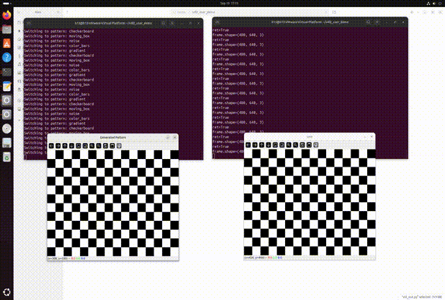

#嵌入式 #Linux驱动开发 #V4L2 

# 1 video loopback示例

本示例依赖系统模块 `videobuf2_v4l2` 和 `videobuf2_vmalloc`

# 2 目录

```toc
```

# 3 特性与实现

运行效果：
- 左侧为图像输入进程(用户->内核，output设备)
- 右侧为图像输出进程(内核->用户，capture设备)
	

## 3.1 基本特性

该示例拥有如下特性：

- 设备特性：
	1. 输出方向(内核->用户)支持的像素格式、分辨率等完全取决于输入方向(用户->内核)
	2. 在输入方向完成像素格式和分辨率等设置之前，输出方向的枚举和设置功能均无效
	3. 只支持单输出(用户->内核)，支持多输出。多输出时，每个输入帧会随机分配到单个输出设备。
	4. <font color="#c00000">单次打开只支持选定一种数据方向</font>，也就是即使是单进程中想要同时使用输入输出，必须分别打开两次设备。
	5. 当需要更改数据方向时，<font color="#c00000">必须先释放当前所有已分配的缓冲区</font>(`VIDIOC_REQBUFS` 时 `reqbufs.count=0` )

## 3.2 loopback数据流动与实现


注意：
- 不应当使用m2m框架，因为m2m为每个打开实例都提供了输入输出两个队列，而进行本驱动的跨文件句柄传输时，每个文件句柄只会有单向输出流，即只会用到其中一个队列。


# 4 专属八股

## 4.1 讲一下虚拟摄像头驱动的缓冲区是如何配置的 ^polx2a

1. 这个虚拟摄像头本质是一个回环设备(`loopback`)，其需要同时支持输入和输出两个方向的数据流，因此这个驱动中配置了输入和输出两个方向的VB2缓冲队列
2. 每一个缓冲队列都需要数据流方向、支持的IO操作类型、驱动中设备对象指针、队列回调函数以及内存分配回调函数
3. 在队列回调函数中，主要需要配置队列的缓冲初始化、缓冲区入队、流开启和流关闭这四个回调
4. 此外，驱动还需要配置两个KFIFO，用于缓存已经被用户态入队、但还没被驱动处理的缓冲区

## 4.2 当用户态的数据到来时，你是如何实现数据拷贝的

1. 简要回答[[Linux内核原理及其开发/minimal-linux-drivers/V4L2/video_device/vloop#^polx2a|缓冲区配置]]中的要点，捋清缓冲区配置
2. 当用户态数据到来时，也就是用户通过 `ioctl` 进行入队后，会触发VB2队列的缓冲区入队回调。当驱动收到入队的缓冲区后，会将缓冲区挂载到驱动的KFIFO队列中。
3. 此外驱动还有一个延迟工作队列，当两个KFIFO均非空时，则会调用延迟工作对象，并在延迟工作对象中完成数据拷贝

## 4.3 如何实现零拷贝帧传递


